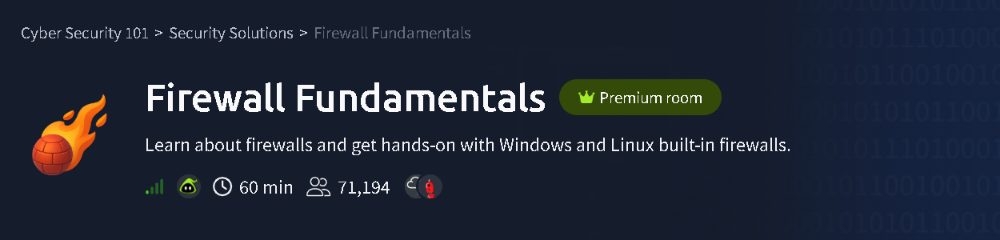
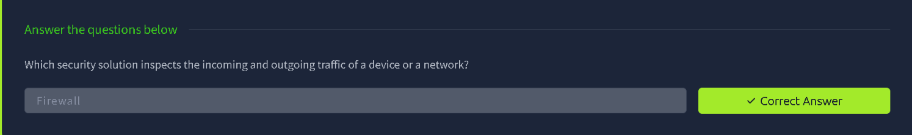
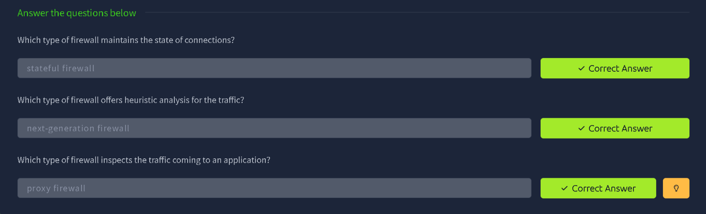
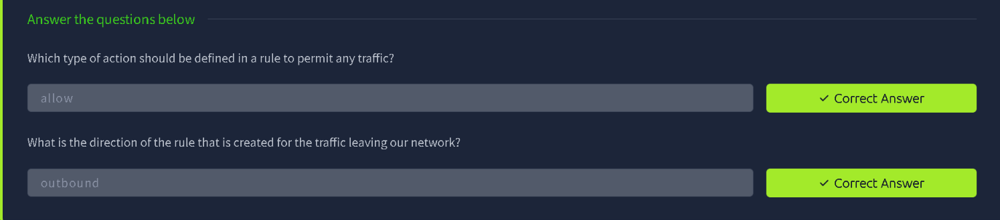
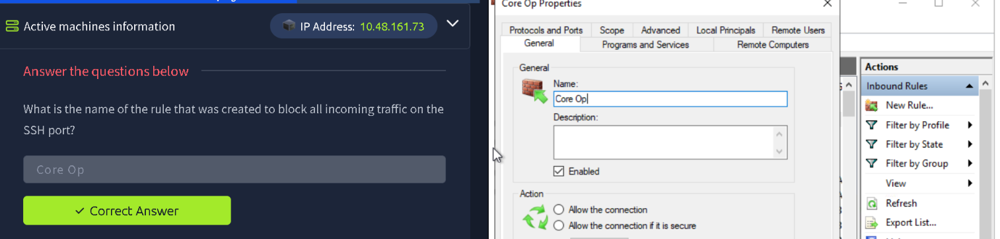
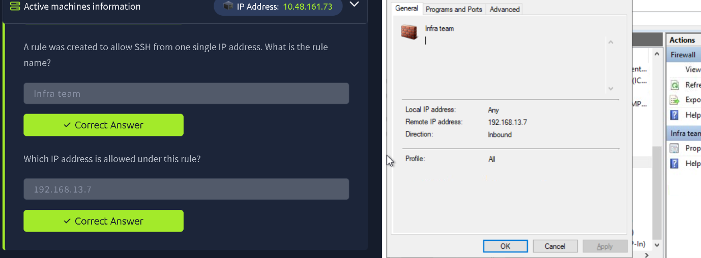
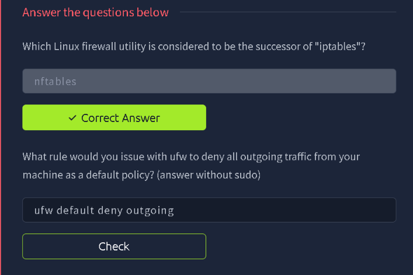

# TryHackMe: Firewall Fundamentals

> **Track:** Cyber Security 101 → Security Solutions
> **Difficulty:** Easy · **Time:** ~60 min
> **Focus:** What firewalls do, the main firewall types, how rules are built, and hands-on inspection of the Windows Defender Firewall plus the Linux firewall tools



---

## Summary

A firewall inspects network traffic and decides, based on rules, whether to let it through. This room covers the theory (types of firewalls and how rules work), then has you read real rules in **Windows Defender Firewall with Advanced Security** and answer questions about the Linux tools `iptables`, `nftables` and `ufw`.

| Part | What I did |
|---|---|
| Concepts | Firewall purpose and the main firewall types |
| Concepts | Rule actions and traffic direction |
| Windows | Inspect inbound rules: the rule blocking SSH, and the rule allowing SSH from a single IP |
| Linux | `nftables` vs `iptables`, and a `ufw` default-deny command |

---

## Step 1: What is a Firewall?

A **firewall** is the security solution that inspects the **incoming and outgoing traffic** of a device or a network and allows or blocks it according to a set of rules.



**Takeaway:** It acts as a gatekeeper between a trusted network and an untrusted one (such as the internet).

---

## Step 2: Types of Firewalls

Firewalls differ in how deeply they look at traffic:

| Type | Key behaviour |
|---|---|
| **Stateless** | Judges each packet on its own, with no memory of earlier packets |
| **Stateful** | **Tracks the state of connections**, so it can tell if a packet belongs to an established session |
| **Proxy firewall** | Sits between client and server and inspects traffic **at the application level** |
| **Next-generation firewall (NGFW)** | Adds deeper features such as **heuristic analysis**, intrusion prevention and application awareness |

The room's questions map to these:

- Maintains the state of connections → **stateful firewall**
- Offers heuristic analysis of traffic → **next-generation firewall**
- Inspects traffic coming to an application → **proxy firewall**



**Takeaway:** The more layers a firewall can inspect, the more it can catch, usually at the cost of performance.

---

## Step 3: Firewall Rules

A firewall rule is made of a few building blocks: the **action**, the **direction**, and match criteria such as IP address, port and protocol.

- **Action:** what to do with matching traffic. To permit traffic, the action is **allow** (the alternatives are to deny or drop it).
- **Direction:** which way the traffic is travelling.
  - **Inbound** traffic is coming into the network or host.
  - **Outbound** traffic is **leaving** the network or host.



**Takeaway:** Rules are evaluated against these properties, so being precise about action and direction is what makes a rule do what you intend.

---

## Step 4: Windows Defender Firewall (Hands-On)

The room provides a Windows machine. I opened **Windows Defender Firewall with Advanced Security** and went to **Inbound Rules**, where each rule can be opened to see its properties.

### 4.1 Find the rule that blocks incoming SSH

Looking through the inbound rules for one targeting the SSH port (TCP 22), the blocking rule is named **Core Op**. Its **Properties → General** tab shows the name and that the rule is enabled. The **Action** section is where the allow/block setting lives.



> **Tip:** The **Protocols and Ports** tab of a rule shows the port it applies to, and the **Action** section shows whether it allows or blocks. Checking both confirms what a rule really does, rather than trusting its name.

### 4.2 Find the rule that allows SSH from a single IP

Another rule was created to allow SSH from one specific address. It's called **Infra team**. Its summary shows:

| Field | Value |
|---|---|
| Local IP address | Any |
| Remote IP address | `192.168.13.7` |
| Direction | Inbound |
| Profile | All |

So the single allowed address is **`192.168.13.7`**.



**Takeaway:** This is a common real-world pattern: block a service for everyone, then add a narrow allow rule for a trusted admin host. Rule scope (the **Remote IP address** field) is what makes the exception safe.

---

## Step 5: Linux Firewall Tools

Linux has several firewall front-ends:

- **`iptables`:** the classic packet-filtering tool.
- **`nftables`:** the modern **successor to `iptables`**.
- **`ufw` (Uncomplicated Firewall):** a friendlier front-end for managing rules.

To deny **all outgoing traffic** by default with `ufw`, the command (without `sudo`) is:

```bash
ufw default deny outgoing
```

This sets the default policy for outbound traffic to *deny*, so only traffic you explicitly allow can leave the machine.



> **Heads up:** Setting a default-deny *outgoing* policy blocks everything leaving the host, including DNS and updates, until you add allow rules. On a remote machine, make sure you've allowed your own SSH access first so you don't lock yourself out.

---

## Note on the Flag

This room's questions are answered directly in the answer fields and there is **no separate flag to capture**, so nothing needed redacting.

---

## Key Takeaways

1. A **firewall** inspects inbound and outbound traffic against **rules**.
2. **Stateful** firewalls track connections, **proxy** firewalls inspect at the application level, and **NGFWs** add heuristic analysis.
3. Every rule has an **action** (allow or deny) and a **direction** (inbound or outbound).
4. Narrow **allow rules scoped to one IP** are a safe way to permit admin access.
5. `nftables` replaces `iptables`, and `ufw default deny outgoing` sets a strict default outbound policy.

## Skills Practised

`Firewalls` · `Windows Defender Firewall` · `Inbound/Outbound Rules` · `nftables` · `iptables` · `ufw` · `Network Security Basics`

---

*Room: [Firewall Fundamentals](https://tryhackme.com/room/firewallfundamentals) on TryHackMe.*
